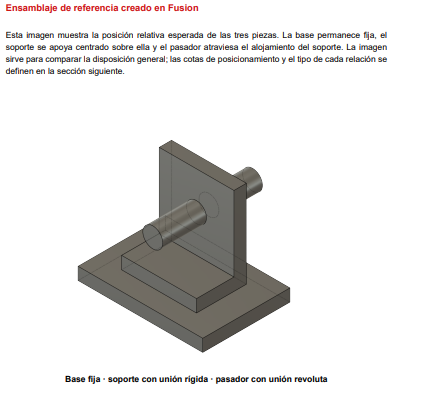
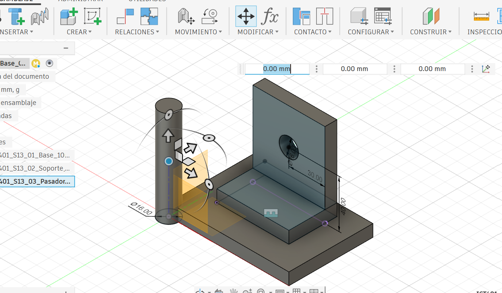
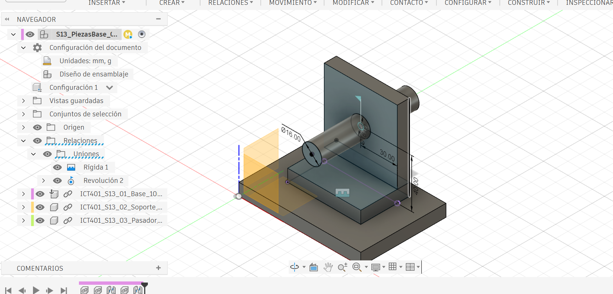
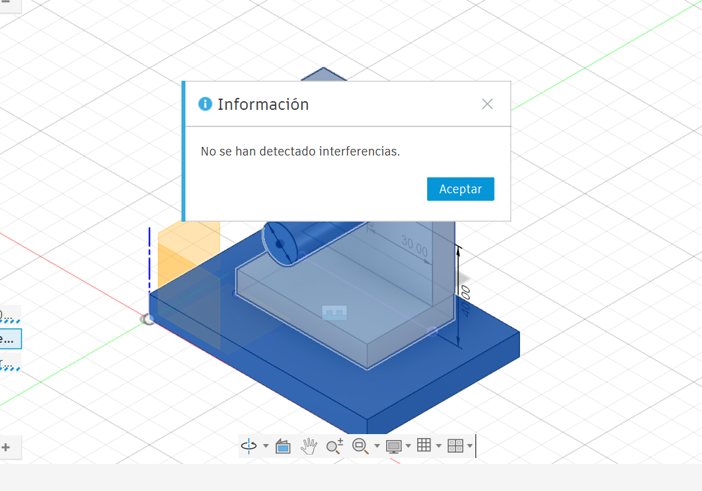
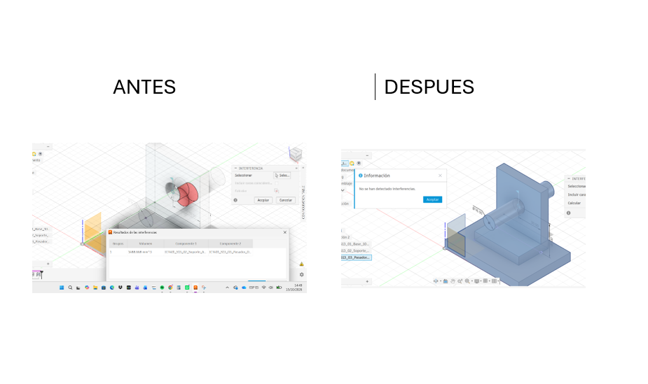

# ICT401 · Semana 13 — Registro de ensamblaje básico

12 al 17 de octubre de 2026.

- Estudiante: Manuel Alejandro Corrales Casanova
- Grupo: [60]
- Proyecto de Fusion Cloud con acceso docente: [MANUEL CORRALES]
- Nombre del diseño de ensamblaje: [S13_PIEZASBASE_CORRALES_ALEJANDRO]
- Piezas base utilizadas: Base, soporte vertical y pasador
- Fecha de trabajo de laboratorio: 15/10/2026
## Instrucciones

Utilice esta plantilla en `Portafolio/semana13/` y guárdela como `S13_Registro_Apellido_Nombre.md`. Sustituya `Apellido_Nombre` por un apellido y un nombre sin espacios ni tildes. Complete cada `[Respuesta]` durante las cuatro lecciones prácticas y agregue las imágenes solicitadas junto con la ficha.

La sesión virtual del miércoles se dedica a la revisión oral del Proyecto Integrador. Este registro corresponde únicamente a las cuatro lecciones prácticas de laboratorio. La actividad es formativa y no sustituye las evaluaciones oficiales posteriores.

Trabaje con las piezas base proporcionadas por la persona docente. Si todavía no se han distribuido, use las imágenes PNG y las dimensiones de esta ficha para construirlas. No modifique los archivos originales ni oculte un componente para evitar una interferencia. Si su versión de Fusion utiliza otro nombre de comando, escriba el nombre real utilizado y describa su función.

Ayuda oficial de Fusion: [Fusion Help](https://help.autodesk.com/view/fusion360/ENU/), sección `Assemblies`.

## Conjunto de trabajo

Dimensiones nominales de referencia: base maciza `100 x 70 x 10 mm`; soporte de `60 mm` de ancho, `70 mm` de alto y `40 mm` de fondo, con alojamiento pasante `diametro 16 mm`; pasador `diametro 16 x 80 mm`.

### Posicionamiento exacto

El soporte se centra sobre la base, no se coloca en una esquina:

- Margen lateral: `20 mm` a cada lado, porque `(100 - 60) / 2 = 20 mm`.
- Margen frontal y posterior: `15 mm` a cada lado, porque `(70 - 40) / 2 = 15 mm`.
- Cara inferior del soporte coincidente con la cara superior de la base.
- Relación base-soporte: `Rígida (Rigid)`.
- Centro del alojamiento: `40 mm` desde la cara inferior del soporte y `30 mm` desde cada lado del soporte.
- Pasador: coaxial con el alojamiento, centrado en el espesor de la pared y con relación `Revolute (Revoluta)`.
- Si la pared mide `10 mm`, el pasador de `80 mm` sobresale aproximadamente `35 mm` a cada lado.

No registre una distancia desde una esquina para ubicar el pasador. Su posición queda definida por el centro del alojamiento.

| Componente | Nombre en Fusion | Función dentro del conjunto | Observación inicial |
|---|---|---|---|
| Base | [Respuesta] | [Respuesta] | [Respuesta] |
| Soporte vertical | [Respuesta] | [Respuesta] | [Respuesta] |
| Eje o pasador | [Respuesta] | [Respuesta] | [Respuesta] |

## Comandos bilingues de Fusion

| Accion | Ruta o comando | Resultado esperado |
|---|---|---|
| Crear diseño | `Archivo > Nuevo diseño (File > New Design)` | Diseño vacío y proyecto confirmado en el Panel de datos. |
| Insertar pieza | `Insertar en el diseño actual (Insert into Current Design)` | Componente visible en el Navegador. |
| Fijar base | Clic derecho en Navegador > `Fijar (Ground)` | La base no se desplaza ni gira. |
| Relacionar soporte | `Ensamblar > Unión (Assemble > Joint)` > `Rígida (Rigid)` | El soporte queda unido a la base. |
| Relacionar pasador | `Ensamblar > Unión (Assemble > Joint)` > `Revoluta (Revolute)` | El pasador gira alrededor de su eje. |
| Probar relación | Clic derecho en la unión > `Animar unión (Drive Joint)` | Se comprueba el movimiento permitido. |
| Revisar interferencias | `Inspeccionar > Interferencia (Inspect > Interference)` > `Calcular (Compute)` | Se identifican cuerpos que ocupan el mismo volumen. |
| Editar relación | Clic derecho en la relación > `Editar (Edit)` | Se corrige origen, orientación, tipo o desplazamiento. |

Registre en cada lección qué componente seleccionó, qué comando utilizó y qué resultado observó. No se considera suficiente escribir solo el nombre de la herramienta.

## L1 — Reconocimiento de piezas y componente base

### Diagnóstico

- ¿Qué pieza funcionará como base y por qué?: La base, porque sirve como referencia fija del conjunto y sobre ella se colocan las demás piezas.
- ¿Qué superficies de la base y del soporte podrían entrar en contacto?: La cara superior de la base y la cara inferior del soporte.
- ¿Qué eje o alojamiento utilizará el pasador?: El alojamiento circular de Ø16 mm del soporte.
- ¿Qué movimiento estaba libre antes de aplicar relaciones?: El soporte podía trasladarse y girar libremente.
- ¿Qué orientación inicial seleccionó y por qué?: Se colocó el soporte aproximadamente centrado sobre la base para preparar el ensamblaje.

### Estado inicial

| Comprobación | Resultado |
|---|---|
| Base insertada como componente | Sí, se insertó como componente dentro del diseño. |
| Base fija o establecida como referencia | Sí, se fijó con el comando Ground/Fijar. |
| Soporte insertado | Sí. |
| Eje o pasador disponible | Sí. |
| Nombres identificables en el navegador | Sí. |

### Evidencia L1

## L2 — Relaciones entre componentes

### Decisiones

| Relación | Componentes o geometrías vinculadas | Movimiento que elimina | Movimiento que conserva | Resultado |
|---|---|---|---|---|
| 1 | Base y soporte vertical | Evita que el soporte se traslade o gire respecto a la base. | No conserva movimiento entre ambos componentes. | El soporte quedó fijo sobre la base. |
| 2 | Soporte vertical y pasador | Evita que el pasador se desplace fuera del alojamiento. | Permite el giro del pasador sobre su propio eje. | El pasador quedó centrado en el agujero y puede girar. |

- Comando o herramienta utilizada: Se utilizó `Joint / Unión` con una relación Rígida para el soporte y una relación Revolución para el pasador.
- ¿Por qué esa relación representa la intención del conjunto?: Porque el soporte debe mantenerse fijo sobre la base, mientras que el pasador sí necesita conservar el giro dentro del alojamiento.
- ¿La orientación del soporte quedó correcta?: Sí, quedó apoyado sobre la base y orientado correctamente.
- ¿Qué movimiento debe conservar el eje?: Debe conservar solamente el movimiento de rotación alrededor de su propio eje.
- ¿Qué movimiento inesperado observó y cómo lo corrigió?: Al inicio el pasador quedó con una unión Rígida, por lo que no podía girar. Se editó la relación y se cambió a Revolución.

### Evidencia L2

## L3 — Revisión de interferencias

- Herramienta utilizada: Inspeccionar > Interferencia.
- Componentes comparados: Soporte vertical y pasador.
- ¿Se encontró una interferencia?: No.
- Ubicación de la condición: No se detectó ninguna zona de interferencia.
- ¿Se trata de interferencia, contacto previsto o separación intencional?: No se detectó interferencia entre los componentes revisados.
- Causa probable: Las piezas quedaron correctamente alineadas y las relaciones se aplicaron de forma adecuada.
- ¿Qué efecto tendría sobre el funcionamiento del conjunto?: El conjunto puede funcionar correctamente, ya que el pasador puede girar y el soporte permanece estable.

| Componente A | Componente B | Zona revisada | Resultado | Evidencia |
|---|---|---|---|---|
| Soporte vertical | Pasador | Alojamiento circular de Ø16 mm | No se detectaron interferencias. | S13_Interferencia_Corrales_Alejandro.png |

### Evidencia L3

## L4 — Corrección, verificación y cierre

### Registro de corrección

- Problema seleccionado: Se provocó una interferencia controlada entre el soporte y el pasador al cambiar temporalmente la posición del pasador.
- Corrección prevista antes de modificar: Volver a colocar el pasador centrado en el alojamiento del soporte.
- Componente o relación modificada: Relación de Revolución del pasador.
- Cambio aplicado: Se corrigió la posición del pasador para que quedara nuevamente alineado con el centro del agujero.
- Resultado del segundo análisis: Después de corregir la posición, Fusion indicó que no se detectaron interferencias.
- ¿La base continúa estable?: Sí.
- ¿El soporte conserva su orientación?: Sí.
- ¿El eje conserva el movimiento esperado?: Sí, el pasador mantiene el giro alrededor de su propio eje.
- Versión o nombre final en Fusion Cloud: [Escriba aquí el nombre con el que guardó el ensamblaje]

| Comprobación final | Resultado | Evidencia o explicación |
|---|---|---|
| Componentes visibles y nombrados | Conforme | La base, el soporte y el pasador se mantienen visibles e identificables en el navegador. |
| Relaciones comprensibles | Conforme | El soporte mantiene una relación Rígida con la base y el pasador una relación de Revolución. |
| Movimiento esperado | Conforme | El soporte permanece fijo y el pasador puede girar sin desplazarse. |
| Interferencia revisada | Conforme | Se detectó una interferencia de 1488.668 mm³ en la condición de prueba y luego se eliminó al corregir la posición del pasador. |
| Corrección documentada | Conforme | Se realizó una comparación de antes y después mostrando el estado con interferencia y el estado corregido. |

### Evidencia L4

`S13_Correccion_Apellido_Nombre.png`: captura comparativa o lámina con el estado problemático y el estado corregido, ambos etiquetados.

## Checklist de cierre

- [x] Las tres piezas base corresponden al conjunto indicado.
- [x] La base está fija o definida como referencia.
- [x] Los componentes tienen nombres identificables.
- [x] Cada relación aplicada tiene una intención explicable.
- [x] El movimiento permitido corresponde a la función del conjunto.
- [x] Se ejecutó una revisión de interferencias.
- [x] La interferencia o ausencia de interferencia quedó interpretada.
- [x] La corrección quedó registrada antes y después.
- [x] El ensamblaje fue guardado en Fusion Cloud.
- [x] La ficha y las imágenes utilizan la nomenclatura solicitada.
- [x] No se adelantaron vistas explosionadas ni listas de componentes.

## Reflexión final

1. ¿Qué diferencia encontró entre insertar piezas y construir un ensamblaje con relaciones?:  
Insertar las piezas solamente hace que aparezcan dentro del diseño, pero al crear las relaciones cada componente queda colocado de acuerdo con la función que debe cumplir dentro del ensamblaje.

2. ¿Qué relación fue más difícil de definir y por qué?:  
La relación del pasador fue la que más costó, porque al principio quedó como rígida y no permitía el giro. Después se cambió a una relación de Revolución para que pudiera moverse correctamente.

3. ¿Cómo distinguió una interferencia de un contacto previsto?:  
La interferencia ocurre cuando dos piezas ocupan el mismo espacio de una forma que no debería pasar. En cambio, un contacto previsto es cuando dos superficies deben tocarse como parte normal del ensamblaje, por ejemplo el soporte apoyado sobre la base.

4. ¿Qué comprobará en Semana 14 antes de generar una vista explosionada o una lista de componentes?:  
Primero comprobaré que las piezas estén bien ubicadas, que las relaciones funcionen correctamente, que el pasador conserve su movimiento y que no existan interferencias que afecten el conjunto.

## Revisión docente

- Observación sobre componentes y nombres: [Respuesta de la persona docente]
- Observación sobre relaciones: [Respuesta de la persona docente]
- Observación sobre interferencias: [Respuesta de la persona docente]
- Corrección sugerida: [Respuesta de la persona docente]
- Estado del registro: Pendiente
