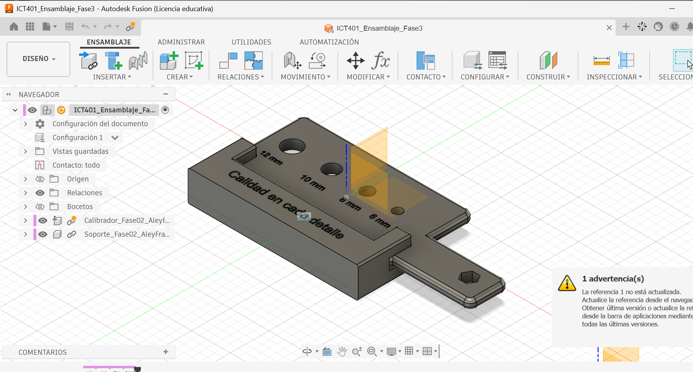
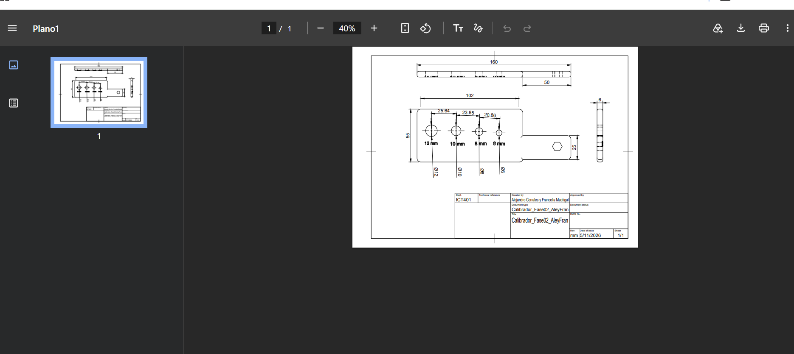
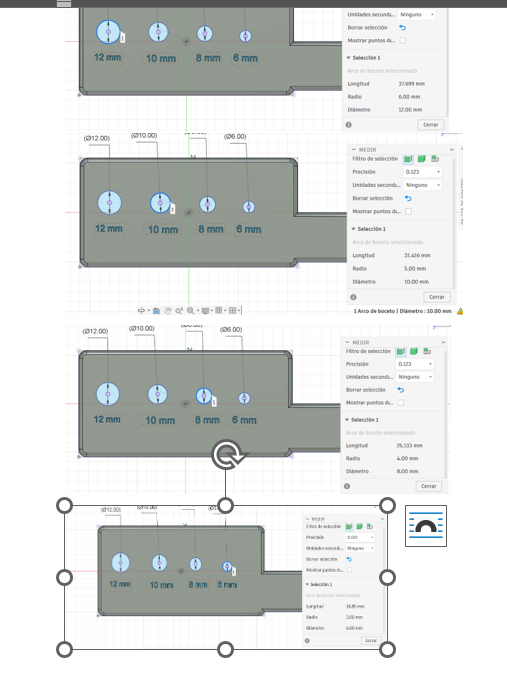

# Ficha de registro: Laboratorio Integrador II-B

**Curso:** ICT401 – Dibujo Técnico Asistido por Computadora  
**Semana:** 16  
**Laboratorio:** Integrador II-B  
**Valor del laboratorio:** 10 %  
**Estudiante o equipo:** Manuel Alejandro Corrales Casanova y Francella Madrigal Vargas  
**Proyecto:** Sistema de calibración de diámetros para tornillos en procesos de producción automotriz  
**Fecha:** 05 de noviembre de 2026  
**Versión inicial:** `ICT401_Ensamblaje_Fase3`  
**Versión evaluada:** `ICT401_Ensamblaje_Fase3` (diseño revisado; número interno de versión no registrado)

## Propósito y alcance

Esta ficha registra la evidencia del Laboratorio Integrador II-B: integración del modelo, ensamblaje, documentación, exportaciones, tolerancias introductorias y control dimensional básico.

La ficha **no sustituye la entrega de la Fase 4 del Proyecto Integrador**, cuyo valor oficial es 7 % y cuyos requisitos se definen en su propia rúbrica. Algunas evidencias pueden reutilizarse si cumplen ambos propósitos, pero deben conservarse separados el registro del laboratorio y la entrega de la fase.

No se evalúan mediante esta ficha la fabricación física, la metrología avanzada, los procesos completos de manufactura ni la presentación final de la Semana 17.

## Instrucciones

1. Complete la ficha durante las cuatro lecciones.
2. Registre la versión exacta del proyecto utilizada.
3. Conserve una copia de respaldo antes de modificar o exportar.
4. Registre el propósito, formato y comprobación de cada archivo de salida.
5. No invente tolerancias cuando no estén indicadas.
6. Cada medición debe incluir característica, unidad, método y limitación.
7. Use nombres o rutas verificables para las evidencias.

Los textos que comienzan con **Ejemplo:** muestran el nivel de detalle esperado. Sustitúyalos por los datos reales de su proyecto; no los copie como resultados propios.

### Ruta general en Fusion

1. Abra el **Data Panel**, localice el proyecto y abra el diseño vigente.
2. En el **Browser**, confirme componentes, cuerpos y el componente raíz.
3. Revise **Document Settings > Units** y anote las unidades activas.
4. Para el plano, abra el **Drawing** correspondiente y revise sus hojas.
5. Para medir, utilice **Inspect > Measure** y seleccione caras, aristas, puntos o diámetros.
6. Para exportar, utilice **File > Export** cuando el formato esté disponible. Para STL, seleccione el cuerpo o componente y use **Save As Mesh**.
7. Si una orden tiene otro nombre, use el buscador de comandos y registre la orden equivalente.

---

## Lección 1. Auditoría del proyecto y documentación

| Elemento | Registro |
|---|---|
| Archivo o enlace principal | Fusion 360, Data Panel: `ICT401_Ensamblaje_Fase3` |
| Versión revisada | `ICT401_Ensamblaje_Fase3` |
| Fecha de la versión | Revisión: 05-11-2026 |
| Unidades del proyecto | Milímetros (mm), comprobados mediante `Document Settings > Units` |
| Plano o Drawing utilizado | `ICT401_Fase4_Plano_Calibrador`, `ICT401_Fase4_Plano_Soporte` y `ICT401_Fase4_Plano_Ensamblaje` |
| Ensamblaje utilizado, si corresponde | `ICT401_Ensamblaje_Fase3` |
| Lista básica de componentes, si corresponde | Calibrador y soporte; no se registró una `Parts List` independiente |
| Ubicación del respaldo inicial | Fusion 360: `ICT401_S16_Ensamblaje_Respaldo_Inicial` |
| Problema prioritario encontrado | Aviso «La referencia 1 no está actualizada» durante la revisión inicial |

### Revisión de coherencia

| Control | Sí | No | N.A. | Evidencia o corrección |
|---|:---:|:---:|:---:|---|
| El modelo y la documentación corresponden a la misma versión. | [ x] | [ ] | [ ] | Se identificaron el ensamblaje y los planos utilizados; no consta la comparación de versiones internas |
| El plano contiene las vistas, cotas y datos que corresponden. | [x] | [ ] | [ ] | Se revisaron los tres planos técnicos |
| El cajetín o identificación está completo según la plantilla. | [x ] | [ ] | [ ] | No consta una comprobación completa de todos los campos |
| La lista coincide con el ensamblaje, cuando corresponde. | [ ] | [ ] | [x] | Se identificaron calibrador y soporte; no se documentó una tabla `Parts List` |
| La orientación y la escala son coherentes. | [x ] | [ ] | [ ] | Se revisaron visualmente los planos, sin registrar las escalas exactas |

**Captura del estado inicial:** `Evidencias/S16_E1_Estado_Inicial.png`

### Evidencia principal de la Lección 1

**Corrección prioritaria antes de exportar:**

Se identificó la necesidad de revisar la referencia desactualizada del ensamblaje y comprobar que la documentación utilizada correspondiera al diseño vigente. No se registró una confirmación definitiva de la desaparición del aviso.

### Evidencias complementarias de la Lección 1

Estas capturas se conservan en la carpeta `Evidencias` y respaldan los registros de auditoría:

| Archivo | Descripción |
|---|---|
| `S16_E1_Respaldo_Inicial.png` | Creación y conservación del respaldo inicial |
| `S16_E1_Revision_Plano_Calibrador.png` | Revisión del plano técnico del calibrador |
| `T16_E1_Revision_Plano_Ensamblaje.png` | Revisión del plano del ensamblaje |
| `S16_E1_Revisión_Plano_Soporte.png` | Revisión del plano técnico del soporte |
| `S16_E1_Verificacion_Unidades.png` | Comprobación de las unidades del proyecto |

---

## Lección 2. Exportaciones y comprobación de archivos

En Fusion, seleccione primero el objeto correcto en el **Browser**. No exporte todo el proyecto si solo se solicita una pieza o un componente.

| Formato | Propósito | Configuración relevante | Archivo generado | Comprobado |
|---|---|---|---|:---:|
| STL | N.A. No se requirió una malla para impresión 3D | No se utilizó `Save As Mesh` | No generado | N.A. |
| STEP | N.A. No se requirió intercambio de geometría 3D | No se efectuó exportación STEP | No generado | N.A. |
| DXF | Intercambio de geometría bidimensional del calibrador y del soporte | Exportación de los planos a DXF | `ICT401_Fase4_Plano_Calibrador Plano1.dxf` y `ICT401_Fase4_Plano_Soporte Plano dxt.dxf` | [x] |
| PDF | Documentación técnica de las piezas y el ensamblaje | Exportación de los tres Drawings a PDF | `ICT401_Fase4_Plano_Calibrador.pdf`, `ICT401_Fase4_Plano_Soporte.pdf` y `ICT401_Fase4_Plano_Ensamblaje.pdf` | [x] |
| Otro | N.A. No se utilizó otro formato | N.A. | No generado | N.A. |

Marque `N.A.` cuando un formato no corresponda al proyecto y justifique la decisión.

### Comprobación de cada salida

| Archivo | Geometría | Unidades | Escala/orientación | Versión | Ubicación | Resultado |
|---|:---:|:---:|:---:|:---:|---|---|
| `ICT401_Fase4_Plano_Calibrador.pdf` | [x] | [x] | [ ] | [ ] | Fase 4 | PDF abierto y revisado |
| `ICT401_Fase4_Plano_Soporte.pdf` | [x] | [x] | [ ] | [ ] | Fase 4 | PDF abierto y revisado |
| `ICT401_Fase4_Plano_Ensamblaje.pdf` | [x] | [x] | [ ] | [ ] | Fase 4 | PDF abierto y revisado |
| `ICT401_Fase4_Plano_Calibrador Plano1.dxf` | [x] | [ ] | [ ] | [ ] | Fase 4 | DXF abierto y revisado |
| `ICT401_Fase4_Plano_Soporte Plano dxt.dxf` | [x] | [ ] | [ ] | [ ] | Fase 4 | DXF abierto y revisado |

**Archivo o captura de comprobación:** `Evidencias/S16_E2_Comprobacion_PDF_Calibrador.png`

### Evidencia principal de la Lección 2

**Discrepancia encontrada:**

No se registraron errores de apertura de los PDF o DXF. No consta una comprobación completa de la escala, orientación y versión interna de cada salida.

**Corrección aplicada:**

Se abrieron y revisaron los archivos fuera del comando de exportación, con el fin de comprobar su visualización.

### Evidencias complementarias de la Lección 2

| Archivo | Descripción |
|---|---|
| `S16_E2_Comprobacion_PDF_Soporte.png` | Apertura y revisión del PDF del soporte |
| `S16_E2_Comprobacion_PDF_Ensamblaje.png` | Apertura y revisión del PDF del ensamblaje |

Las comprobaciones de los dos DXF se realizaron durante el laboratorio, pero sus capturas no aparecen entre los archivos mostrados en la carpeta de evidencias.

---

## Lección 3. Tolerancias y control dimensional básico

En Fusion, la ruta de comprobación es **Design > Inspect > Measure**. En el resultado de la medición deben poder reconocerse la geometría seleccionada y la unidad.

No agregue una tolerancia que no esté indicada en el plano, la rúbrica o la instrucción correspondiente.

| Característica | Dimensión nominal | Tolerancia | Límite inferior | Límite superior | Valor observado | Unidad |
|---|---:|---|---|---|---:|---|
| Diámetro del calibrador Ø6 | 6 | No definida | N.A. | N.A. | 6,00 | mm |
| Diámetro del calibrador Ø8 | 8 | No definida | N.A. | N.A. | 8,00 | mm |
| Diámetro del calibrador Ø10 | 10 | No definida | N.A. | N.A. | 10,00 | mm |
| Diámetro del calibrador Ø12 | 12 | No definida | N.A. | N.A. | 12,00 | mm |

### Método y resultado

| Característica | Herramienta o método | Resultado | Limitación de la comprobación |
|---|---|---|---|
| Diámetro Ø6 | `Inspect > Measure`, arco circular del boceto | Coincide con el nominal: 6,00 mm | Medición digital; no certifica una pieza física |
| Diámetro Ø8 | `Inspect > Measure`, arco circular del boceto | Coincide con el nominal: 8,00 mm | No se definió tolerancia de aceptación |
| Diámetro Ø10 | `Inspect > Measure`, arco circular del boceto | Coincide con el nominal: 10,00 mm | No permite comprobar errores de fabricación |
| Diámetro Ø12 | `Inspect > Measure`, arco circular del boceto | Coincide con el nominal: 12,00 mm | No certifica una pieza fabricada |

**Ejemplo de cálculo, si corresponde:**

Diferencia = valor observado − valor nominal

- Ø6: 6,00 − 6,00 = **0,00 mm**
- Ø8: 8,00 − 8,00 = **0,00 mm**
- Ø10: 10,00 − 10,00 = **0,00 mm**
- Ø12: 12,00 − 12,00 = **0,00 mm**

**Captura o referencia de la medición:** `Evidencias/S16_E3_Control_Dimensional_4_Agujeros.png`

### Evidencia principal de la Lección 3

**¿Qué valor o criterio no pudo comprobarse?**

No fue posible comprobar la conformidad de los cuatro diámetros respecto a límites de tolerancia, porque no se establecieron tolerancias específicas para ellos. Las mediciones se realizaron sobre arcos circulares del boceto en Fusion 360 y no sobre piezas fabricadas.

---

## Lección 4. Integración y cierre del laboratorio

Después de corregir, guarde la versión evaluada desde **File > Save** o la orden equivalente. Compruebe que el archivo exportado y la ficha se refieran a esa misma versión.

### Correcciones finales

| Problema | Acción aplicada | Resultado | Evidencia |
|---|---|---|---|
| Aviso de referencia no actualizada | Se identificó y revisó la advertencia en Fusion 360 | Se reconoció la necesidad de actualizar la referencia; no consta su resolución definitiva | `S16_E1_Estado_Inicial.png` |
| Necesidad de comprobar las exportaciones | Se abrieron y revisaron los PDF y DXF | Se documentó la comprobación de tres PDF y dos DXF | Capturas de la Lección 2 |
| Necesidad de verificar dimensiones | Se utilizó `Inspect > Measure` en cuatro arcos del boceto | Se observaron valores de 6, 8, 10 y 12 mm, coincidentes con los nominales | `S16_E3_Control_Dimensional_4_Agujeros.png` |

**Captura de revisión final:** `S16_E4_Revision_Final_Ensamblaje.png`

### Evidencia principal de la Lección 4

La revisión final corresponde al ensamblaje del calibrador y su soporte. La captura `S16_E4_Revision_Final_Ensamblaje.png` fue registrada durante el trabajo, pero no aparece entre los archivos de la carpeta mostrada; por eso no se inserta una imagen que pudiera quedar rota.

### Checklist del Laboratorio II-B

- [x ] La versión del modelo y la documentación coincide. No se registró el número interno exacto.
- [x] El plano final fue revisado.
- [x] Se identificaron los componentes calibrador y soporte; no se documentó una `Parts List` formal.
- [x] Cada archivo exportado tiene un propósito registrado.
- [x] Las salidas fueron revisadas fuera del comando de exportación.
- [x ] Se registraron unidades, escala, orientación y versión. Las unidades y los nombres de archivos sí se registraron, pero no todos los demás datos.
- [x] Se realizó al menos una comprobación dimensional básica.
- [x] Las tolerancias introductorias fueron interpretadas sin inventar valores.
- [x] Se registraron las discrepancias y las acciones de revisión.
- [ x] La versión evaluada fue respaldada. Se conserva el respaldo inicial, sin una segunda copia evaluada.
- [x] La ficha contiene los registros de las cuatro lecciones.

### Evidencias finales del laboratorio

| Evidencia | Nombre o ruta | Completa | Observaciones |
|---|---|:---:|---|
| Estado inicial y auditoría | `Evidencias/S16_E1_Estado_Inicial.png` | [x] | Captura principal de la Lección 1 |
| Exportaciones y comprobación | `Evidencias/S16_E2_Comprobacion_PDF_Calibrador.png` | [x] | Captura principal de la Lección 2 |
| Control dimensional | `Evidencias/S16_E3_Control_Dimensional_4_Agujeros.png` | [x] | Cuatro mediciones digitales |
| Plano final o documentación | `Evidencias/T16_E1_Revision_Plano_Ensamblaje.png` | [x] | Revisión del plano del ensamblaje |
| Lista básica, si corresponde | `ICT401_Ensamblaje_Fase3` | [x] | Calibrador y soporte identificados |
| Archivo de respaldo | `ICT401_S16_Ensamblaje_Respaldo_Inicial` | [x] | Respaldo inicial conservado |
| Ficha completa | `README.md` | [x] | Registro de las cuatro lecciones |

### Evidencias complementarias conservadas

Las capturas adicionales se encuentran en la carpeta `Evidencias`, sin insertarlas como imágenes grandes en el documento:

| Archivo | Contenido |
|---|---|
| `S16_E1_Respaldo_Inicial.png` | Respaldo inicial |
| `S16_E1_Revision_Plano_Calibrador.png` | Plano del calibrador |
| `T16_E1_Revision_Plano_Ensamblaje.png` | Plano del ensamblaje |
| `S16_E1_Revisión_Plano_Soporte.png` | Plano del soporte |
| `S16_E1_Verificacion_Unidades.png` | Unidades del proyecto |
| `S16_E2_Comprobacion_PDF_Soporte.png` | Comprobación del PDF del soporte |
| `S16_E2_Comprobacion_PDF_Ensamblaje.png` | Comprobación del PDF del ensamblaje |

---

## Separación de la Fase 4

**¿Qué producto o archivo adicional exige la rúbrica de la Fase 4?**

La Fase 4 corresponde a una entrega independiente de documentación técnica del Proyecto Integrador. Para nuestro proyecto se elaboraron los planos del calibrador, soporte y ensamblaje, junto con sus archivos PDF y DXF. Los requisitos adicionales deben contrastarse con la rúbrica oficial de Fase 4.

**¿Qué evidencia de esta ficha puede reutilizarse en la Fase 4?**

Se pueden reutilizar las capturas de revisión de planos, los archivos PDF y DXF, y la documentación del ensamblaje. Las mediciones digitales también pueden servir como evidencia complementaria de revisión geométrica.

**¿Qué requisito de la Fase 4 todavía no está cubierto por esta ficha?**

Esta ficha no sustituye la entrega independiente de la Fase 4 ni la verificación de todos sus criterios. No consta la comparación de versiones internas del modelo y los planos ni la resolución definitiva del aviso de referencia.

---

## Cierre reflexivo

**¿Qué exportación requirió más comprobación y por qué?**

Los archivos DXF requirieron mayor atención porque permiten intercambiar geometría bidimensional y es importante comprobar que las líneas, dimensiones y unidades se interpreten correctamente. Los PDF también se revisaron para verificar la visualización de los planos técnicos.

**¿Qué diferencia encontró entre el valor nominal, la tolerancia y el valor observado?**

El valor nominal es la dimensión establecida en el diseño. La tolerancia es la variación permitida y el valor observado es el resultado de una medición. En nuestro proyecto, los valores observados de 6, 8, 10 y 12 mm coincidieron con los nominales, pero no se definieron tolerancias de aceptación para esos diámetros.

**¿Qué corrección mejoró la confiabilidad del producto técnico?**

La revisión de los planos, la comprobación de los archivos exportados y la verificación digital de los cuatro diámetros permitieron organizar mejor la documentación y comprobar que las dimensiones medidas coincidieran con el diseño.

**¿Qué limitación debe comunicar antes de considerar terminada la Fase 4?**

Las mediciones realizadas son digitales y no certifican una pieza fabricada. Además, las tolerancias de los diámetros del calibrador no están definidas y la entrega de Fase 4 debe verificarse por separado con su rúbrica oficial.
