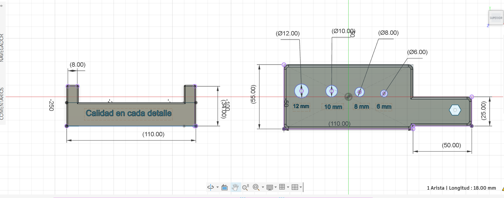
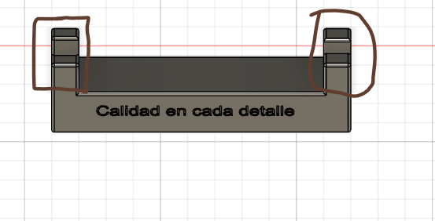
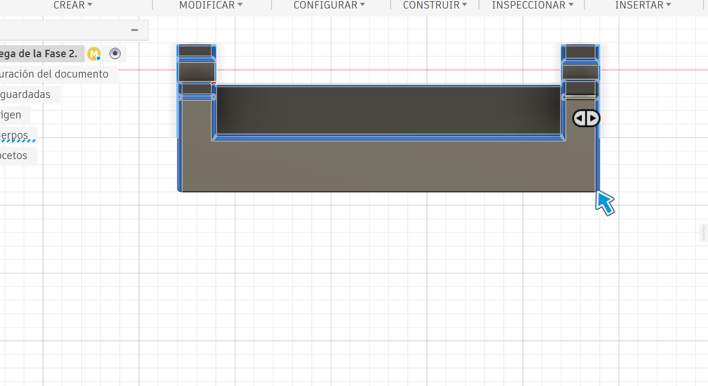
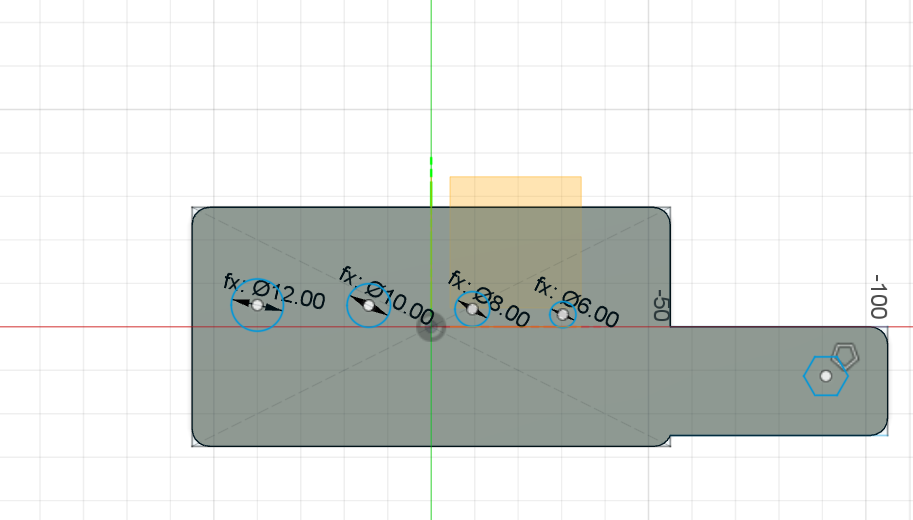
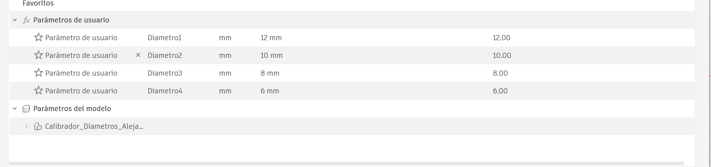
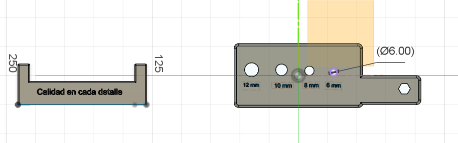

# Proyecto Integrador – Fase 2

## Modelado paramétrico inicial del calibrador y su soporte

**Universidad:** Universidad Nacional de Costa Rica – Sede Regional Chorotega, Campus Liberia  
**Curso:** ICT401 – Dibujo Técnico Asistido por Computadora  
**Proyecto:** Sistema de calibración de diámetros para tornillos en procesos de producción automotriz  
**Integrantes:** Manuel Alejandro Corrales Casanova y Francella Madrigal Vargas  
**Profesor:** Óscar Caravaca Mora  
**Fecha del informe:** 8 de octubre de 2026

## 1. Objetivo y descripción del proyecto

El objetivo de esta fase fue **construir y documentar el modelo tridimensional paramétrico** de dos piezas complementarias en Autodesk Fusion: un calibrador de diámetros nominales de tornillos y un soporte para su colocación y almacenamiento. Se utilizaron bocetos acotados, restricciones geométricas, operaciones de modelado, empalmes y parámetros de usuario, además de una prueba de modificación paramétrica.

El calibrador permite realizar una **comprobación preliminar de tamaños nominales**; no constituye por sí solo una verificación metrológica de tolerancias industriales, ya que estas no se especificaron en la fase documentada.

*Figura 1. Vista general de las dos piezas modeladas en Fusion.*

## 2. Construcción del calibrador

### 2.1. Definición geométrica mediante bocetos

Se elaboró una pieza alargada con cuerpo principal, mango y cuatro agujeros identificados con sus diámetros nominales. Para controlar la geometría se utilizaron **bocetos (Sketch), cotas y restricciones geométricas**. El informe original documenta las siguientes dimensiones:

| Elemento | Dimensión documentada |
|---|---:|
| Longitud del cuerpo principal | 110 mm |
| Longitud del mango | 50 mm |
| Longitud total aproximada | 160 mm |
| Ancho del cuerpo principal | 55 mm |
| Ancho del mango | 25 mm |
| Diámetros nominales de los agujeros | 6, 8, 10 y 12 mm |

*Figura 2. Bocetos acotados y dimensiones principales del calibrador y del soporte.*

### 2.2. Generación de los agujeros mediante extrusión de corte

A partir de los perfiles circulares se empleó **Extrude (Extrusión)** en modalidad de corte para generar los agujeros. En la captura adicional se observa una **distancia de extrusión de −30 mm**; el signo negativo indica la dirección de la operación respecto del plano de referencia. Se documenta como **recorrido del corte**, sin asumir que el espesor final de la pieza sea de 30 mm.

*Figura 3. Operación de extrusión de corte de los perfiles seleccionados, con distancia de −30 mm.*

### 2.3. Empalme de aristas del calibrador

Se aplicó **Fillet (Empalme)** a aristas exteriores del cuerpo principal y del mango, con el fin de redondear las transiciones y mejorar el acabado geométrico. La captura muestra las aristas seleccionadas y el historial de operaciones; **no se consigna un radio de empalme** porque no se aprecia en la evidencia.

*Figura 4. Selección de aristas exteriores para aplicar empalmes al calibrador.*

## 3. Construcción del soporte

### 3.1. Geometría y función de los parales

Se modeló un soporte con base y **dos parales verticales ubicados en los extremos**. Su finalidad es proporcionar zonas de apoyo y una posición definida para colocar y almacenar el calibrador. La captura permite identificar la disposición de los parales; la comprobación del contacto efectivo entre piezas se reservó para la etapa de integración.

*Figura 5. Vista del soporte con los dos parales destinados a sostener el calibrador.*

### 3.2. Empalme de aristas del soporte

Se empleó **Fillet (Empalme)** sobre aristas seleccionadas del soporte para redondear bordes y mejorar las transiciones de su geometría. No se indica el radio de curvatura porque la captura no lo especifica.

*Figura 6. Aristas seleccionadas para la operación de empalme del soporte.*

## 4. Parametrización de los diámetros

Se crearon **parámetros de usuario** para controlar los cuatro diámetros nominales. Las cotas de los bocetos se vincularon a estos valores mediante expresiones paramétricas, lo que permite actualizar la geometría sin rehacer manualmente los bocetos ni los cortes.

*Figura 7. Cotas de los agujeros asociadas a expresiones paramétricas.*

*Figura 8. Tabla de parámetros de usuario del modelo.*

## 5. Prueba de modificación paramétrica

Para verificar la respuesta del diseño se realizó la siguiente comprobación:

1. Se identificó el parámetro del agujero de **6 mm**.
2. Se cambió temporalmente su valor a **7 mm**.
3. Se comprobó que Fusion actualizó la geometría del agujero sin reconstruir el boceto ni repetir el corte.
4. Se restauró el valor original de **6 mm** para conservar las dimensiones previstas.

*Figura 9. Estado original del agujero de 6 mm.*

*Figura 10. Prueba temporal del cambio paramétrico de 6 mm a 7 mm.*

## 6. Organización e historial del modelo

El diseño mantuvo visibles sus **bocetos, cuerpos e historial de operaciones** en el navegador y en la línea de tiempo de Fusion. Esta organización permite localizar y modificar operaciones anteriores, y facilita el trabajo posterior de integración. En la Fase 2 las dos geometrías se conservaron diferenciadas dentro del mismo diseño.

*Figura 11. Navegador y línea de tiempo con la organización del modelado.*

## 7. Resumen de técnicas aplicadas

| Técnica de Fusion | Aplicación | Evidencia |
|---|---|---|
| Sketch, cotas y restricciones | Definición de perfiles y dimensiones | Figura 2 |
| Extrude / Cut | Corte de los perfiles circulares; recorrido de −30 mm | Figura 3 |
| Fillet | Redondeo de aristas del calibrador | Figura 4 |
| Modelado de soporte con parales | Geometría de apoyo del calibrador | Figura 5 |
| Fillet | Redondeo de aristas del soporte | Figura 6 |
| Parámetros de usuario | Control de los diámetros nominales | Figuras 7 y 8 |
| Edición paramétrica | Cambio temporal de 6 a 7 mm y restauración | Figuras 9 y 10 |
| Historial de operaciones | Seguimiento y edición de operaciones | Figura 11 |

## 8. Resultados y alcance

Se obtuvo el **modelo inicial del calibrador y su soporte**, con agujeros nominales de 6, 8, 10 y 12 mm, geometría definida mediante cotas y parámetros editables. Se documentaron empalmes en ambas piezas y una operación de corte de 30 mm de recorrido. La prueba de modificación de 6 a 7 mm mostró que el modelo respondió al cambio paramétrico y permitió restaurar el valor original.

**Alcance de la Fase 2:** construcción digital y verificación paramétrica inicial. El ensamblaje con relaciones entre componentes y las comprobaciones de interferencias, separación y alineación se desarrollaron en la **Fase 3**.

## 9. Archivos de entrega

- [**Fase 2. Proyecto Integrador.pdf**](Fase%202.%20Proyecto%20Integrador.pdf): informe original con el modelado y las siete figuras iniciales.
- **`Evidencias/`**: siete imágenes originales ya publicadas en GitHub y cuatro capturas complementarias de construcción, para un total de **11 evidencias**.
- **Autodesk Fusion Cloud**: diseño editable correspondiente a la entrega de la fase.

## 10. Contribuciones

- **Manuel Alejandro Corrales Casanova:** desarrollo del calibrador de diámetros.
- **Francella Madrigal Vargas:** desarrollo del soporte del calibrador.

**Nota de trazabilidad:** las dimensiones y la prueba paramétrica provienen del informe original. Las cuatro capturas adicionales documentan los empalmes, la extrusión de corte y la geometría de apoyo del soporte. No se asignan radios de empalme, espesores ni secuencias de operaciones que no estén acreditados por las evidencias.

