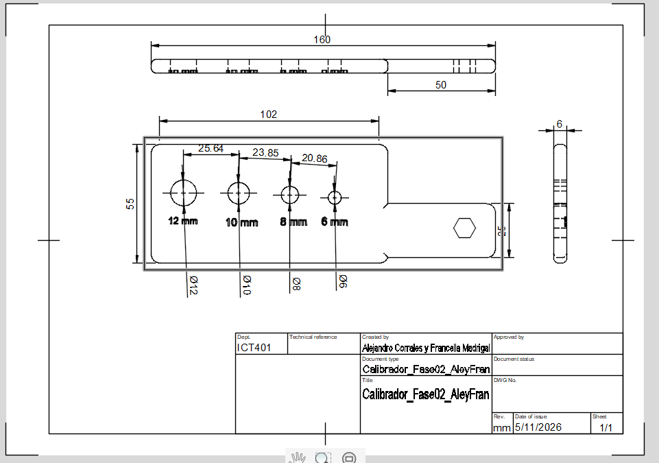
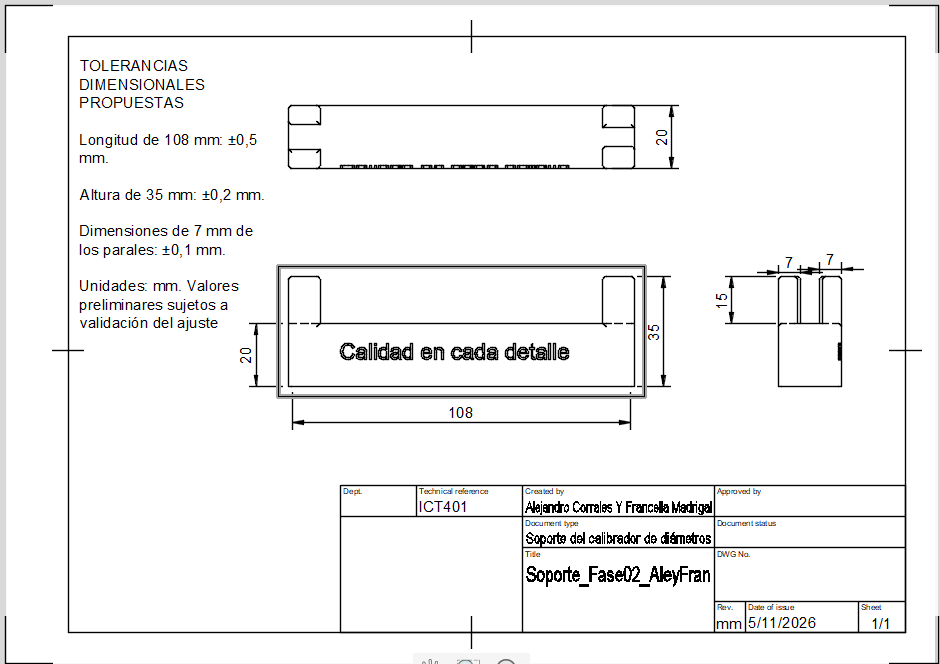
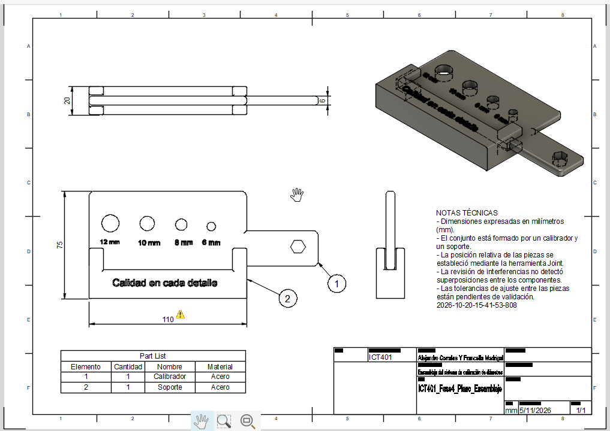
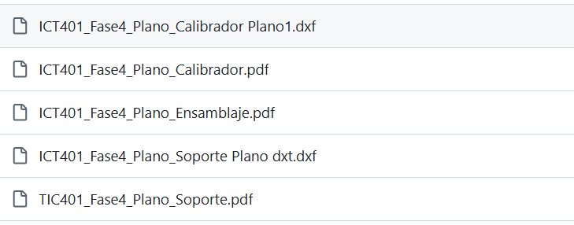

# Fase 4: Documentación y archivos finales

## Proyecto integrador

**Sistema de calibración de diámetros para tornillos en procesos de producción automotriz**

**Universidad:** Universidad Nacional de Costa Rica  
**Sede:** Regional Chorotega, Campus Liberia  
**Curso:** ICT401 – Dibujo Técnico Asistido por Computadora  
**Profesor:** Óscar Caravaca Mora

**Integrantes:**
- Manuel Alejandro Corrales Casanova
- Francella Madrigal Vargas

---

## 1. Introducción

En esta cuarta fase de nuestro proyecto integrador nos enfocamos en realizar la documentación técnica del sistema de calibración de diámetros para tornillos.

Después de diseñar las piezas y realizar el ensamblaje en las fases anteriores, utilizamos Autodesk Fusion 360 para elaborar los planos técnicos del calibrador, del soporte y del ensamblaje completo.

En esta etapa agregamos las vistas, dimensiones y notas técnicas necesarias para representar nuestro diseño de una forma más clara. También preparamos los archivos PDF y DXF y organizamos las evidencias en GitHub.

## 2. Objetivo

Elaborar y organizar los planos técnicos y los archivos finales de nuestro proyecto, de manera que se puedan identificar las características de cada pieza, sus dimensiones y la forma en que se relacionan dentro del ensamblaje.

---

## 3. Desarrollo de la Fase 4

### 3.1. Elaboración del plano técnico del calibrador

Primero trabajamos en el plano técnico del calibrador, que es la pieza principal de nuestro proyecto.

Utilizamos las herramientas de dibujo de Fusion 360 para colocar las diferentes vistas y agregar las dimensiones del cuerpo, el mango y los agujeros.

El calibrador cuenta con cuatro agujeros de diámetros nominales de 6 mm, 8 mm, 10 mm y 12 mm, que permiten comprobar diferentes tamaños de tornillos.

También completamos el cajetín del plano con la información correspondiente al proyecto.

**Evidencia 1. Plano técnico del calibrador**

En esta imagen se observa el plano técnico del calibrador, donde se representan sus vistas, dimensiones y los cuatro agujeros.

**Evidencia 2. Archivo PDF del calibrador**

[Ver plano técnico del calibrador en PDF](Evidencias/ICT401_Fase4_Plano_Calibrador.pdf)

Este archivo contiene el plano del calibrador en formato PDF, lo que permite consultar sus dimensiones y características sin necesidad de abrir Fusion 360.

**Evidencia 3. Archivo DXF del calibrador**

También preparamos el archivo DXF del calibrador para contar con un formato que pueda utilizarse en otros programas de dibujo técnico.

### 3.2. Elaboración del plano técnico del soporte

Después realizamos el plano técnico del soporte, que es la pieza encargada de sostener el calibrador dentro del sistema.

En este plano colocamos las vistas necesarias para mostrar su forma y agregamos las dimensiones principales de la base y de los parales.

Entre las medidas representadas se encuentran una longitud de 108 mm, una profundidad de 20 mm y una altura total de 35 mm.

Al finalizar, revisamos la presentación del plano y completamos el cajetín.

**Evidencia 4. Plano técnico del soporte**

En esta captura se puede observar el plano del soporte, con sus diferentes vistas y las medidas necesarias para comprender su geometría.

**Evidencia 5. Archivo PDF del soporte**

[Ver plano técnico del soporte en PDF](Evidencias/ICT401_Fase4_Plano_Soporte.pdf)

Este documento contiene la representación técnica del soporte, incluyendo las dimensiones principales de su estructura.

**Evidencia 6. Archivo DXF del soporte**

Además del PDF, preparamos el archivo DXF del soporte para conservar su información de dibujo en otro formato.

### 3.3. Elaboración del plano técnico del ensamblaje

Una vez terminados los planos individuales, trabajamos en el plano técnico del ensamblaje completo.

Para esto utilizamos el modelo desarrollado en la Fase 3, donde habíamos unido el calibrador y el soporte mediante la herramienta Joint de Fusion 360.

Colocamos diferentes vistas del conjunto, incluyendo una vista isométrica para observar mejor la ubicación de las piezas.

También agregamos las dimensiones generales, los globos de identificación y una lista de componentes.

El conjunto está formado por dos piezas principales: un calibrador y un soporte.

**Evidencia 7. Plano técnico del ensamblaje**

En esta imagen se observa el plano del ensamblaje completo, con sus vistas, dimensiones generales y lista de componentes.

**Evidencia 8. Archivo PDF del ensamblaje**

[Ver plano técnico del ensamblaje en PDF](Evidencias/ICT401_Fase4_Plano_Ensamblaje.pdf)

Este documento permite visualizar cómo se encuentran ubicadas las piezas dentro del conjunto y consultar la información técnica del ensamblaje.

### 3.4. Revisión de dimensiones y notas técnicas

Durante la elaboración de los planos revisamos que las dimensiones representadas correspondieran con los modelos que habíamos diseñado anteriormente.

También agregamos notas técnicas para indicar las unidades de medida y algunas características importantes de las piezas.

Las dimensiones se expresaron en milímetros. Los agujeros del calibrador se identificaron mediante sus diámetros nominales, mientras que los criterios de tolerancia y ajuste quedaron sujetos a validación según los requisitos de fabricación.

### 3.5. Organización de los archivos en GitHub

Después de preparar los planos y los archivos DXF, los subimos a nuestro repositorio de GitHub.

Organizamos los documentos correspondientes a la Fase 4 y agregamos este README para explicar el trabajo realizado.

Esto nos permite mantener un registro de los resultados y facilitar la consulta de los archivos del proyecto.

**Evidencia 9. Entrega de la Fase 4 en GitHub**

En esta captura se muestra la organización de los archivos que forman parte de nuestra entrega, incluyendo los planos PDF, los archivos DXF.
---

## 4. Resultados obtenidos

Al finalizar esta fase logramos elaborar los tres planos técnicos principales de nuestro proyecto: calibrador, soporte y ensamblaje.

También conseguimos representar las dimensiones de las piezas, agregar una lista de componentes al ensamblaje y preparar los documentos en PDF.

Además, generamos los archivos DXF del calibrador y del soporte, y organizamos los resultados en GitHub.

Durante este proceso aprendimos a utilizar mejor las herramientas de dibujo técnico de Fusion 360 y a presentar nuestros diseños mediante documentos que contienen información más detallada.

## 5. Dificultades durante el proceso

Durante esta fase tuvimos algunas dificultades al colocar las dimensiones en los planos, organizar las vistas y encontrar los archivos DXF después de exportarlos.

También fue necesario revisar varias veces la presentación de los dibujos para asegurarnos de que la información fuera clara.

Sin embargo, logramos resolver estos inconvenientes y continuar con la documentación del proyecto.

Estas situaciones nos ayudaron a comprender mejor el funcionamiento de Fusion 360 y la importancia de revisar los archivos antes de entregarlos.

## 6. Conclusión

En esta cuarta fase logramos realizar la documentación técnica de nuestro sistema de calibración de diámetros para tornillos.

Consideramos que esta etapa fue importante porque nos permitió mostrar de una manera más clara las piezas diseñadas anteriormente, sus dimensiones y cómo se relacionan dentro del ensamblaje.

También comprendimos que no basta con realizar un modelo tridimensional, sino que es necesario elaborar planos y preparar archivos que permitan interpretar mejor el diseño.

Finalmente, organizamos los planos, los archivos DXF y las evidencias en GitHub, dejando documentado el trabajo realizado durante esta fase del proyecto integrador.
