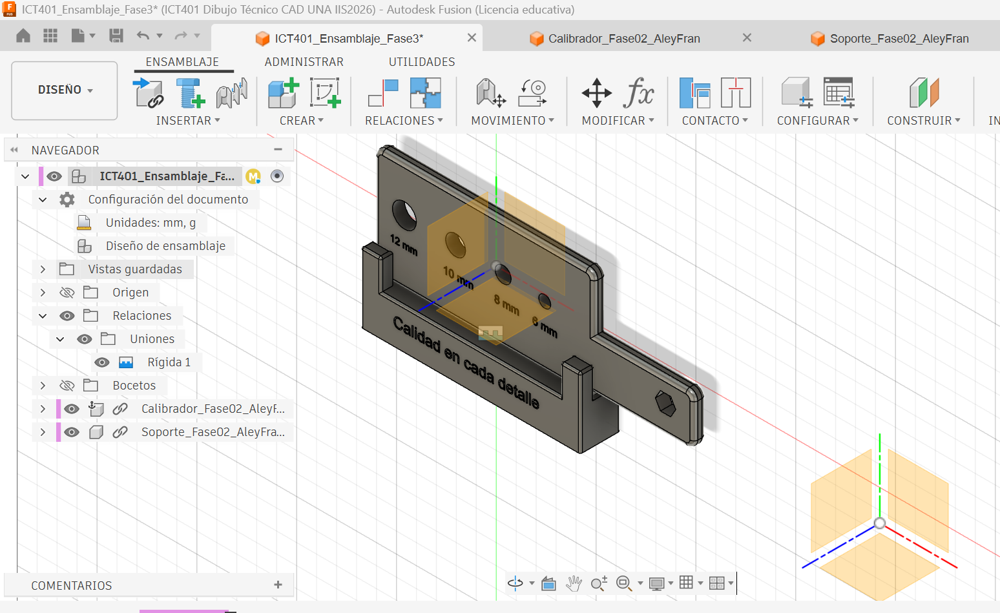

# Proyecto Integrador – Fase 3

## Integración y validación del ensamblaje

**Curso:** ICT401 – Dibujo Técnico Asistido por Computadora

**Proyecto:** Sistema de calibración de diámetros para tornillos en procesos de producción automotriz.

**Integrantes:**
- Manuel Alejandro Corrales Casanova
- Francella Madrigal Vargas

## Descripción

En esta fase se realizó la integración o bien el ensamblaje del calibrador de diámetros y su soporte mediante Autodesk Fusion 360. Se utilizaron archivos independientes realizados en esta fase para cada componente y se estableció su posición mediante la herramienta Joint.

Posteriormente, se realizaron revisiones de interferencias, alineación, separación y dimensiones. El análisis de interferencias no detectó superposiciones entre los componentes y se registró una separación de 1,555 mm entre las superficies medidas.

La principal dificultad fue que inicialmente las dos piezas estaban en un mismo archivo, lo que complicaba trabajar con ellas por separado. Para solucionarlo, se crearon dos copias del diseño y se dejó un componente en cada una. Así fue posible realizar el ensamblaje sin modificar el archivo original.

El ensamblaje quedó guardado en Fusion Cloud con la versión **Entrega Fase 3**.

##  Bitácora de trabajo 

| Actividad | Trabajo realizado | Resultado |
|---|---|---|
| Preparación de piezas | El calibrador y el soporte estaban diseñados en un mismo archivo. Se utilizó **Save As** para crear dos copias y dejar cada pieza por separado, sin modificar el diseño original. | Se obtuvieron los archivos independientes `Calibrador` y `Soporte`. |
| Ensamblaje | Se insertaron ambas piezas en un nuevo archivo y se utilizó **Joint** para colocarlas en su posición. | Ensamblaje realizado. |
| Interferencias | Se utilizó **Interference** para revisar si las piezas se superponían. | No se detectaron interferencias. |
| Separación | Se utilizó **Measure** para medir la distancia entre las superficies seleccionadas. | Separación de **1,555 mm**. |
| Alineación | Se revisó la posición del calibrador entre los parales del soporte. | Alineación revisada visualmente. |
| Dimensiones | Se comprobaron los agujeros del calibrador. | Diámetros de **6, 8, 10 y 12 mm**. |
| Guardado | Se guardó el ensamblaje en Fusion 360. | Versión **Entrega Fase 3**. |

## Archivos de la entrega

- `Informe_Fase3.pdf`: informe del ensamblaje y sus comprobaciones.
- `F03_Ensamblaje_General.png`: vista general del conjunto.
- `F03_Sin_Interferencias.png`: resultado de la revisión de interferencias.
- `F03_Separacion_1.555mm.png`: medición de separación entre componentes.
- `F03_Alineacion_Ensamblaje.png`: vista superior del ensamblaje.
- `F03_Validacion_Dimensiones.png`: comprobación de los cuatro diámetros nominales.

## Contribuciones individuales

**Manuel Alejandro Corrales Casanova:** diseño del calibrador de diámetros.

**Francella Madrigal Vargas:** diseño del soporte del calibrador.

**Trabajo conjunto:** integración de los componentes y revisión geométrica del ensamblaje.

## Observación

Se logró ensamblar el calibrador y su soporte, revisar sus dimensiones y comprobar que no existieran interferencias.
