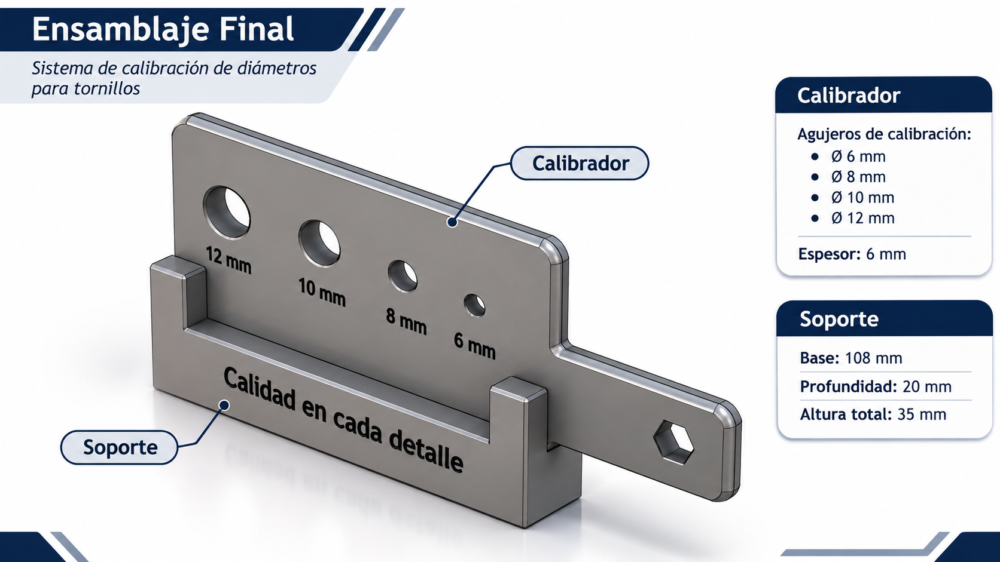

# PORTAFOLIO TÉCNICO FINAL

## Proyecto Integrador – ICT401

**Universidad Nacional de Costa Rica**  
**Sede Regional Chorotega**  
**Curso:** ICT401 – Dibujo Técnico Asistido por Computadora  
**Docente:** Óscar Caravaca Mora  
**Proyecto:** Sistema de calibración de diámetros para tornillos en procesos de producción automotriz  
**Integrantes:** Manuel Alejandro Corrales Casanova y Francella Madrigal Vargas  
**Fecha:** Noviembre de 2026

---
<h2 align="center">⚙️ SISTEMA DE CALIBRACIÓN DE DIÁMETROS</h2>
<h3 align="center">Vista general del ensamblaje final</h3>

  

  <em>Figura 1. Modelo tridimensional del calibrador y su soporte, desarrollado en Autodesk Fusion 360.</em>

---

## 1. Introducción

Este portafolio técnico reúne los archivos finales y la documentación del Proyecto Integrador desarrollado durante el curso ICT401.

El proyecto consistió en diseñar un sistema de calibración de diámetros para tornillos utilizados en procesos de producción automotriz. Para ello se empleó Autodesk Fusion 360, mediante el cual se desarrollaron los modelos tridimensionales, el ensamblaje y los planos técnicos.

El portafolio permite consultar los resultados del proyecto y conservar los archivos necesarios para revisar o modificar el diseño.

## 2. Problema y objetivo

En los procesos de producción automotriz es importante identificar correctamente las dimensiones de los tornillos para evitar errores durante el montaje.

Como propuesta de solución se diseñó un calibrador con cuatro agujeros de diámetros nominales diferentes, acompañado de un soporte.

**Objetivo general:** Diseñar y documentar un sistema de calibración de diámetros para tornillos mediante herramientas de dibujo técnico asistido por computadora.

## 3. Desarrollo del proyecto

### Fase 1. Planteamiento

Se identificó la necesidad técnica y se propuso desarrollar un calibrador que permitiera identificar distintos diámetros nominales de tornillos.

### Fase 2. Modelado 3D

Se modelaron las dos piezas principales del proyecto:

- **Calibrador:** pieza con cuatro agujeros nominales de 6, 8, 10 y 12 mm.
- **Soporte:** estructura con una base y dos elementos verticales para sostener el calibrador.

Se utilizaron herramientas de bocetado, acotación y modelado tridimensional de Fusion 360.

### Fase 3. Ensamblaje

Se realizó el ensamblaje digital del calibrador y su soporte mediante relaciones de unión (*Joint*).

Durante las comprobaciones digitales no se detectaron interferencias en la configuración revisada. También se registró una separación de 1,555 mm entre las superficies seleccionadas durante una medición.

### Fase 4. Planos técnicos

Se elaboraron tres planos técnicos:

1. Plano del calibrador.
2. Plano del soporte.
3. Plano del ensamblaje.

Los planos incluyen vistas y dimensiones de los componentes. El plano del ensamblaje incorpora además una lista básica de piezas.

Los documentos se exportaron en formato PDF y se prepararon archivos DXF de los dibujos individuales.

## 4. Descripción del diseño

### Calibrador

| Característica | Dimensión |
|---|---|
| Longitud total | 160 mm |
| Ancho del cuerpo | 55 mm |
| Ancho del mango | 25 mm |
| Espesor | 6 mm |
| Agujeros nominales | 6, 8, 10 y 12 mm |

### Soporte

| Característica | Dimensión |
|---|---|
| Longitud de la base | 108 mm |
| Profundidad | 20 mm |
| Altura total | 35 mm |
| Elementos verticales | 2 |

### Lista de componentes

| N.º | Componente | Cantidad |
|---|---|---|
| 1 | Calibrador | 1 |
| 2 | Soporte | 1 |

## 5. Archivos CAD editables

Los siguientes archivos contienen los modelos originales de Fusion 360 y permiten consultar o modificar el diseño.

**Calibrador**

[Ver archivo CAD del calibrador](ICT401_Calibrador_Final.f3d.f3d)

**Soporte**

[Ver archivo CAD del soporte](ICT401_Soporte_Final.f3d.f3d)

**Ensamblaje**

[Ver archivo CAD del ensamblaje](ICT401_Ensamblaje_Final.f3d.f3z)

El ensamblaje se conserva en formato F3Z, utilizado por Fusion 360 para proyectos que contienen diseños vinculados.

## 6. Planos técnicos finales

Los siguientes documentos PDF permiten consultar las vistas y dimensiones de las piezas.

### Plano del calibrador

[Ver plano técnico del calibrador en PDF](ICT401_Fase4_Plano_Calibrador.pdf)

### Plano del soporte

[Ver plano técnico del soporte en PDF](TIC401_Fase4_Plano_Soporte.pdf)

### Plano del ensamblaje

[Ver plano técnico del ensamblaje en PDF](ICT401_Fase4_Plano_Ensamblaje.pdf)

## 7. Archivos de fabricación e intercambio

Durante el desarrollo del proyecto se exportaron dibujos técnicos en formato DXF para facilitar su intercambio con otros programas de diseño asistido por computadora.

Los archivos corresponden a:

- Calibrador.
- Soporte.

El formato DXF permite intercambiar información geométrica de dibujo técnico, mientras que el PDF facilita la visualización de los planos y los archivos nativos de Fusion 360 conservan la posibilidad de editar los modelos.

## 8. Organización de la documentación

Los archivos CAD editables y los planos PDF se encuentran reunidos en la misma ubicación que este documento.

La documentación del desarrollo y las evidencias realizadas durante las fases anteriores se conservan en el repositorio original del Proyecto Integrador.

Esta organización permite diferenciar los resultados finales de los registros utilizados durante el proceso de diseño, sin necesidad de duplicar evidencias.

## 9. Comprobaciones técnicas

Durante el desarrollo del proyecto se realizaron revisiones digitales relacionadas con:

- Los diámetros nominales de los agujeros.
- Las dimensiones principales del calibrador y del soporte.
- La posición de las piezas dentro del ensamblaje.
- Las relaciones de unión entre componentes.
- La existencia de posibles interferencias.
- La representación de las piezas en los planos técnicos.

Las dimensiones se trabajaron en milímetros.

Las comprobaciones fueron digitales y no sustituyen la verificación dimensional de una pieza fabricada.

## 10. Decisiones técnicas

Una de las decisiones más importantes fue incorporar cuatro diámetros nominales en una sola pieza para facilitar la identificación de diferentes tamaños de tornillos.

También se diseñó un soporte independiente para complementar el calibrador.

Durante el proceso se revisaron las dimensiones y las relaciones entre componentes para conseguir una representación coherente del conjunto.

## 11. Resultados obtenidos

Se completaron los siguientes productos:

- Modelo tridimensional del calibrador.
- Modelo tridimensional del soporte.
- Ensamblaje digital.
- Tres planos técnicos en PDF.
- Exportaciones DXF del calibrador y del soporte.
- Archivos editables de Fusion 360.
- Documentación de las fases del Proyecto Integrador.

## 12. Limitaciones y mejoras futuras

El sistema se desarrolló como un diseño digital, por lo que todavía sería necesario fabricar un prototipo para comprobar su funcionamiento en condiciones reales.

También sería importante establecer y validar tolerancias dimensionales adecuadas para la comprobación de tornillos.

Como mejoras futuras se propone fabricar un prototipo, realizar pruebas con tornillos reales y evaluar materiales apropiados para su utilización.

## 13. Control final del portafolio

Antes de la entrega se debe comprobar que:

- Los archivos CAD se puedan abrir correctamente.
- El ensamblaje conserve sus componentes.
- Los planos PDF sean legibles.
- Los archivos DXF correspondan a los diseños definitivos.
- Las dimensiones de los planos coincidan con los modelos finales.
- Los archivos estén respaldados.
- Cada integrante pueda explicar el proceso y las decisiones técnicas.

## 14. Conclusiones

El desarrollo del Proyecto Integrador permitió aplicar los conocimientos adquiridos durante el curso de Dibujo Técnico Asistido por Computadora.

A lo largo del semestre se logró transformar una propuesta inicial en modelos tridimensionales, un ensamblaje y documentación técnica.

También se comprendió la importancia de revisar las dimensiones, comprobar las relaciones entre componentes y conservar los archivos en formatos adecuados.

Finalmente, este portafolio reúne los resultados del proyecto y facilita su revisión, presentación y posible mejora en el futuro.

---

**Proyecto Integrador – ICT401**  
**Universidad Nacional de Costa Rica**  
**Noviembre de 2026**
